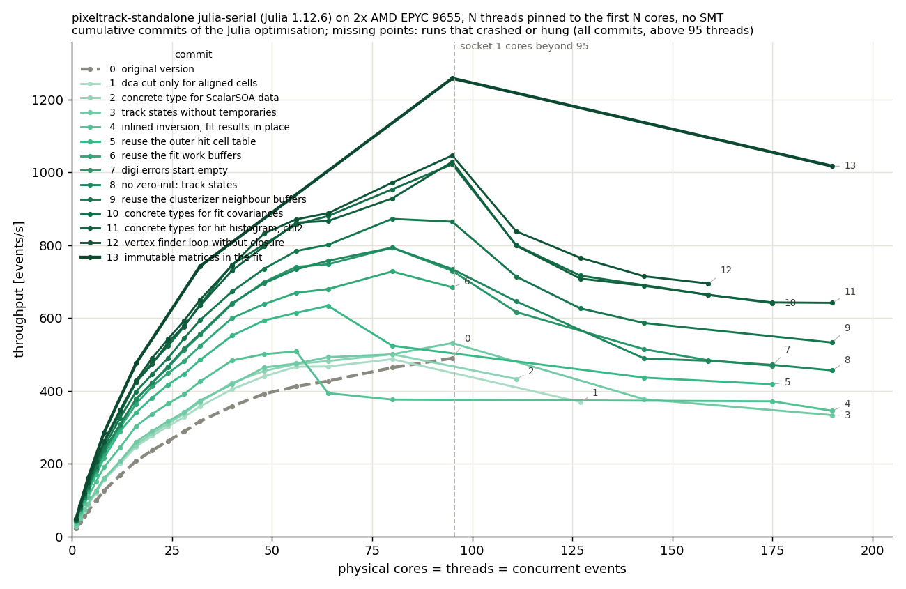
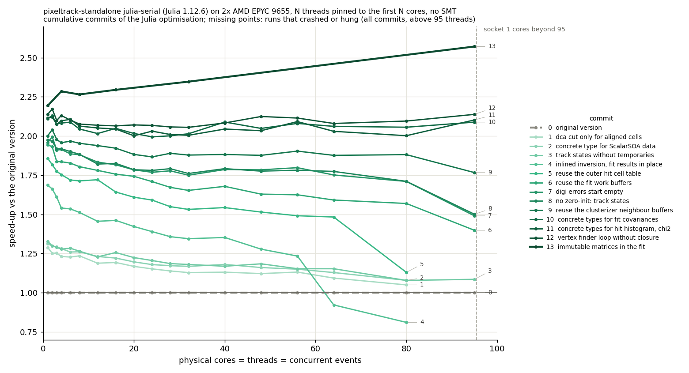

# Optimisation of the `julia-serial` back-end

The `julia-serial` back-end is optimised with one commit per change, so that the effect of each change can be measured on its own. Most changes remove heap allocations and dynamic dispatch, which account for most of the difference with respect to the C++ version: a struct field of a non-concrete type, a temporary array, or a work buffer allocated for every event costs both the allocation and, with many threads, the time spent in the stop-the-world garbage collector.

The results are unchanged: for every commit, a checksum of the products of 300 events (the numbers of digis and clusters; the pt, eta, chi2, quality, state and covariance of each fitted track; the vertices) is identical to that of `master`, with 1 and with 8 concurrent streams. The checksums are also identical with Julia 1.12.6, 1.12.7 and 1.13.1.

## Changes

1. **Evaluate the dca cut only for the aligned pairs of cells**: in `kernel_connect` the dca cut, which builds a circle through the three hits, was evaluated for every pair of cells, also when the cheaper alignment cut had already failed; evaluate it only for the aligned pairs, as the C++ does.
2. **Concrete type for the data of `ScalarSOA`**: `MArray{Tuple{S},Scalar}` leaves two parameters of `MArray` open, so every access to the pt, eta, chi2 and quality of the tracks went through dynamic dispatch and allocated a box.
3. **Fill the track states without temporary arrays**: `copyFromCircle!` built two heap arrays for every track; build static vectors instead.
4. **Inline the matrix inversion and update the fit results in place**: mark the generic `invert()` `@inline`, so that the static matrices of the Broken Line fit passed to it need not live on the heap, and write the covariances and parameters of the circle and line fits in place rather than replacing them with new arrays.
5. **Keep the table of the cells of each outer hit across events**: `build_doublets` allocated a new 128 x n_hits table (about 8 MB) for every event; keep it in the kernels object and only reset its column lengths.
6. **Keep the work buffers of the track fits across events**: about 5 MB per event, now kept in a task-local value, one set for each stream.
7. **Start the digi errors empty**: the vector started with `MAX_FED_WORDS` default entries, allocated and filled for every event; start it empty, as the `SimpleVector` of the C++ does.
8. **Do not zero-initialise the track states**: the state and covariance of a track are written by its fit and only read for the fitted tracks.
9. **Reuse the neighbour buffers of the clusterizer**: `find_clus` allocated the nearest-neighbour matrix and counters for every module; use the task-local buffers that were already defined for this.
10. **Concrete types for the covariances of the fit results**: `MMatrix{3,3,Float64}` leaves the length parameter open, so the fields were abstractly typed.
11. **Concrete types for the hit histogram and the chi2 coefficients**: after this change no struct field of the package has an abstract type, apart from small unions with `Nothing`.
12. **Find the closest denser track without a closure**: in `cluster_tracks_by_density` the closure updating the distance found so far boxed the distance; write the scan over the neighbouring bins out.
13. **Propagate the fit covariances with immutable matrices**: the `jacobian * cov * jacobian'` products of the Broken Line fit multiplied mutable static matrices, whose results were allocated on the heap; take immutable copies of explicit size.

Together, these changes reduce the allocations per event from about 185 to 37 thousand, and the memory allocated per event from about 32 MB to 9.5 MB.

## What did not help

- **Unsized static matrices for the covariance propagation**: `SMatrix(jacobian) * SMatrix(cov) * SMatrix(jacobian)'` without explicit sizes is slower than the original code (37.2 to 32.9 events/s at 1 thread), because the size is not known at compile time. A first version of commit 13 was also slower, because the covariance fields were still abstractly typed; it became a gain after commit 10.
- **`@view` for the columns of the outer hit cell table**: no effect, `PreAllocMatrix` already returns a view.
- **`zeros(MMatrix{...})` instead of `@MArray zeros(...)`**, and **passing the hits to `bulk_fill` as an immutable copy**: no change in the allocations.
- **Garbage collector settings**: with 32 threads, 8, 16 (the default set by `julia-serial`) or 32 GC threads, with or without `--heap-size-hint=64G`, give the same throughput within 2%.
- **Newer Julia versions**: 1.13.1 is 3-5% faster up to 16 threads, and the same within the noise from 32 threads up; 1.12.7 is the same as 1.12.6. The Julia version is not changed.

Not attempted: the algorithmic changes of the `serial` back-end (union-find clustering, CSR layout of the cells of each hit, branch-free doublet search), and compiling with `--check-bounds=no` or `-O3`.

## Measurements

Measured on a dual-socket AMD EPYC 9655 (Zen 5, 2x 96 cores) with Julia 1.12.6, using only the physical cores (no SMT): a job with N threads and N concurrent events (`JULIA_NUM_THREADS=N`, `JULIA_NUM_GC_THREADS=(N+1)/2,1`, as set by `julia-serial`) is pinned with `taskset` to the first N cores (socket 0 up to 95 threads, then socket 1). Each job processes max(10000, 500 x N) events after max(1000, 10 x N) warm-up events, so the compilation of the code is not part of the measurement; each point is a single run.

With more than 95 threads, and for some of the first commits already with 95 threads, many runs crash with a segmentation fault, in the code or in the garbage collector, or hang: this happens also with `master`, and is not understood. The missing points in the table and in the plots are runs that failed (from commit 7 on, after 3 attempts); with many threads the points that are there vary much more than with fewer threads. Commit 13 was measured only at 1, 4, 8, 16, 32, 95 and 190 threads.

Throughput in events/s, and in parentheses the speed-up with respect to the previous commit:

| commit | 1 thread | 8 threads | 32 threads | 95 threads | 190 threads |
|---|---:|---:|---:|---:|---:|
| `master` | 22.0 | 126.0 | 316.4 | 489.5 | crash |
| 1. dca cut only for aligned cells | 28.3 (1.29x) | 155.6 (1.24x) | 357.1 (1.13x) | crash | crash |
| 2. concrete type for `ScalarSOA` data | 28.9 (1.02x) | 158.9 (1.02x) | 369.6 (1.04x) | crash | crash |
| 3. track states without temporaries | 29.2 (1.01x) | 159.4 (1.00x) | 373.5 (1.01x) | 531.3 | 333.2 |
| 4. inlined inversion, fit results in place | 37.0 (1.27x) | 190.5 (1.20x) | 425.5 (1.14x) | crash | 345.1 (1.04x) |
| 5. reuse the outer hit cell table | 40.8 (1.10x) | 215.9 (1.13x) | 484.6 (1.14x) | crash | crash |
| 6. reuse the fit work buffers | 42.7 (1.05x) | 227.3 (1.05x) | 523.0 (1.08x) | 684.4 | crash |
| 7. digi errors start empty | 43.0 (1.01x) | 236.9 (1.04x) | 553.7 (1.06x) | 729.5 (1.07x) | crash |
| 8. no zero-init: track states | 43.4 (1.01x) | 237.3 (1.00x) | 557.1 (1.01x) | 734.5 (1.01x) | 456.1 |
| 9. reuse the clusterizer neighbour buffers | 43.9 (1.01x) | 246.1 (1.04x) | 594.4 (1.07x) | 864.7 (1.18x) | 532.5 (1.17x) |
| 10. concrete types for fit covariances | 46.4 (1.06x) | 257.6 (1.05x) | 637.3 (1.07x) | 1022.3 (1.18x) | crash |
| 11. concrete types for hit histogram, chi2 | 46.5 (1.00x) | 259.9 (1.01x) | 634.2 (1.00x) | 1029.1 (1.01x) | 641.7 |
| 12. closest denser track without closure | 47.0 (1.01x) | 261.6 (1.01x) | 650.3 (1.03x) | 1046.6 (1.02x) | crash |
| 13. immutable matrices in the fit | 48.2 (1.03x) | 285.4 (1.09x) | 742.5 (1.14x) | 1258.4 (1.20x) | 1017.2 |

Total speed-up with respect to `master`:

| | 1 thread | 8 threads | 32 threads | 95 threads |
|---|---:|---:|---:|---:|
| all commits | 2.19x | 2.27x | 2.35x | 2.57x |

The throughput still drops above one socket: the garbage collector takes 6% of the time with 1 thread, 26% with 32, 35% with 95 and 40% with 190 threads. The remaining allocations come mostly from the `@MArray` local variables of the Broken Line fit and of `find_ntuplets`, which escape to the heap; removing them would need restructuring that code.

Throughput vs number of cores for each commit:

Speed-up with respect to `master` vs number of cores, up to 95 threads:

## Comparison with the `serial` back-end

| threads | `serial` | `julia-serial`, `master` | `julia-serial`, optimised |
|---:|---:|---:|---:|
| 1 | 87.9 | 22.0 | 48.2 |
| 8 | 619.0 | 126.0 | 285.4 |
| 32 | 2337.7 | 316.4 | 742.5 |
| 95 | 5439.7 | 489.5 | 1258.4 |
| 190 | 10383.5 | crash | 1017.2 |

The optimised `julia-serial` runs at about half the speed of the optimised `serial` back-end with 1 thread, and at about a quarter with 95 threads.
