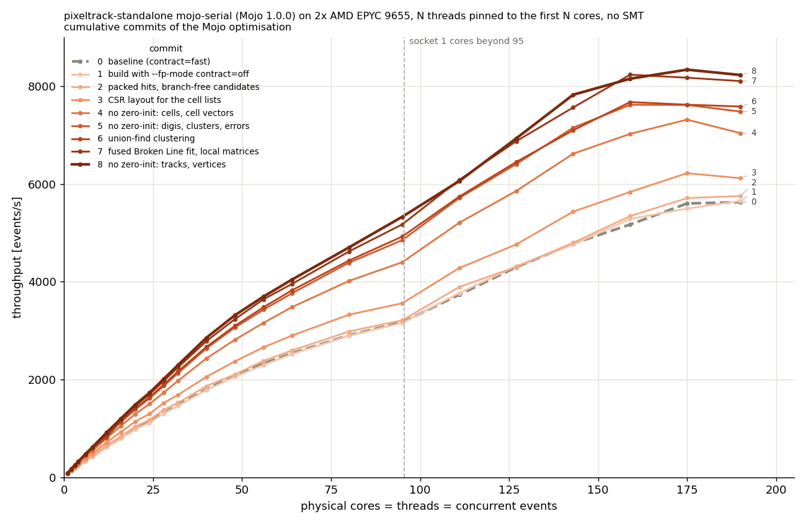
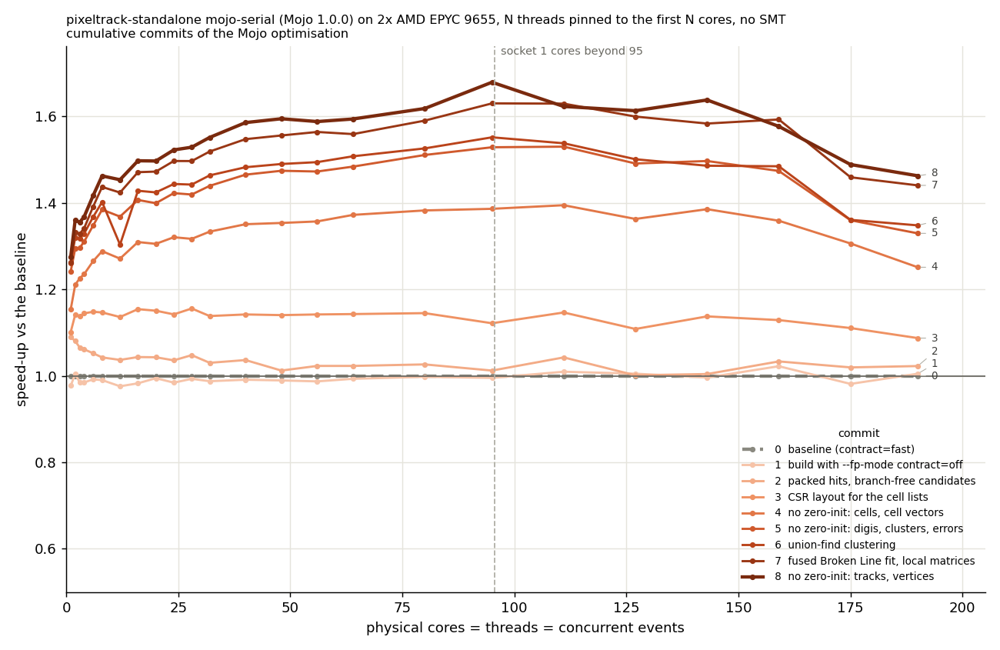
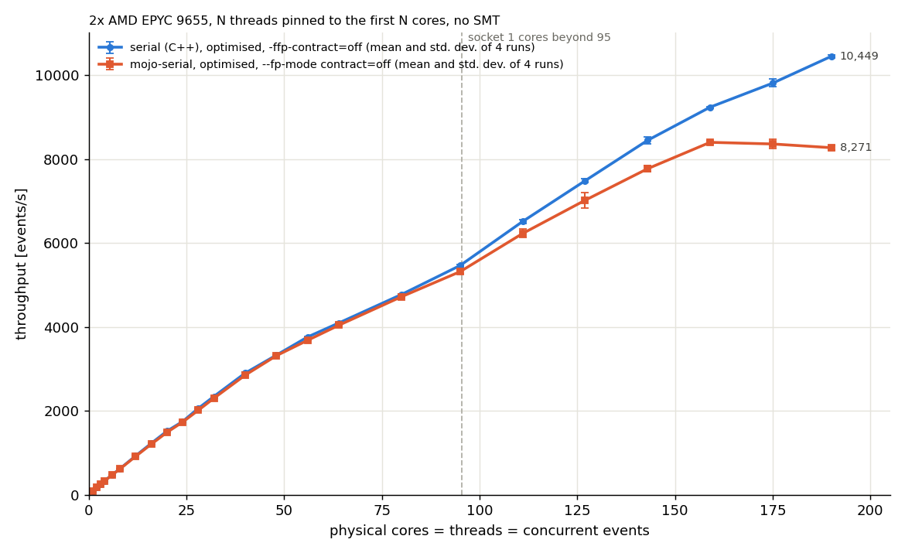

# Optimisation of the `mojo-serial` back-end

The optimisations of the `serial` back-end (see [`doc/serial`](../serial/README.md)) that apply to the Mojo port are ported to `mojo-serial`, with one commit per optimisation, so that the effect of each change can be measured on its own. The first commit adds a build task that does not fuse the multiply-adds across statements, so that the results do not depend on the shape of the code; after that, the results are unchanged: for every commit the checksums of the products of 300 events (the cluster index of each digi; the number of hits, quality, pt, eta and chi2 of each track; the position, weight, chi2, ndof and pT² of each vertex) are identical to those of the original port built with the same flags, with 1 and 8 threads, and also when malloc fills new memory with garbage (`GLIBC_TUNABLES=glibc.malloc.perturb=165`).

## Building

```bash
make mojo-serial    # mojo build ... -O3 --march=native --fp-mode contract=off
./mojo-serial --threads 8 --maxEvents 1000 --validation
```

## Changes

0. **Original port**: the Mojo port as built so far, with the default `--fp-mode contract=fast`.
1. **Build with `--fp-mode contract=off`**: `make mojo-serial` adds `--fp-mode contract=off` to the flags used so far (`-O3 --march=native`, without assertions), the equivalent of `-ffp-contract=off` used for the C++ back-ends. With the default `contract=fast` the compiler fuses multiply-adds also across statements, so that the rounding, and the results, change with the shape of the code; this costs 1-2% of throughput.
2. **Packed hits and branch-free candidate selection in the doublet search**: as in the `serial` back-end, the quantities of the outer hits used by the doublet search are copied into a compact array in the order of the phi histogram, and for each phi bin the candidates that pass the cheaper cuts are selected without branching, before applying the other cuts and creating the doublets in the original order.
3. **CSR layout for the cells of each outer hit**: the list of 128-entry `VecArray` (516 bytes per hit), copied and reset for every event, is replaced by an array of offsets and an array of cell indices, filled in cell order after the doublet search; the cells of each hit and the 128 cells limit are unchanged.
4. **No zero-initialisation of the cells and of the cell vectors**: the cells, and the vectors of the neighbours and of the tracks of each cell, are written before they are read.
5. **No zero-initialisation of the digi, cluster and error buffers**: they are fully written by the kernels before being read; this avoids writing about 10 MB per event in scalar loops.
6. **Union-find for the pixel clustering**: as in the `serial` back-end, the iterative min-label propagation designed for GPUs is replaced by a union-find that keeps the smallest pixel index as the root of each set; the cluster ids are identical.
7. **Fused Broken Line fit with local matrices**: the fast fit and the fit of each n-tuplet are done together, and the hits are kept in local matrices instead of the strided buffers used to coalesce memory accesses on GPUs; this avoids allocating and zeroing about 5 MB of buffers per event.
8. **No zero-initialisation of the tracks, the vertices and the vertex finder work space.**

The other optimisations of the `serial` back-end are not needed: `mojo build` already optimises with `-O3` for the host CPU by default, the Mojo `HistoContainer` already used plain increments, and tuning glibc malloc (`GLIBC_TUNABLES=glibc.malloc.mmap_threshold=...:glibc.malloc.trim_threshold=...`) has no measurable effect on the Mojo binary.

## Measurements

Measured on a dual-socket AMD EPYC 9655 (Zen 5, 2x 96 cores) with Mojo 1.0.0, using only the physical cores (no SMT): a job with N threads and N concurrent events is pinned with `taskset` to the first N cores (socket 0 up to 95 threads, then socket 1). Each job processes max(10000, 500 x N) events after max(1000, 10 x N) warm-up events; each point is a single run, and the run-to-run variation is about 0.3% up to 95 threads, and 1-2% above.

Throughput in events/s, and in parentheses the speed-up with respect to the previous commit:

| commit | 1 thread | 8 threads | 32 threads | 95 threads | 190 threads |
|---|---:|---:|---:|---:|---:|
| 0. original port (`contract=fast`) | 68.9 | 422.9 | 1480.4 | 3174.4 | 5627.1 |
| 1. `--fp-mode contract=off` | 67.3 (0.98x) | 418.7 (0.99x) | 1461.9 (0.99x) | 3159.1 (1.00x) | 5653.9 (1.00x) |
| 2. packed hits, branch-free candidates | 75.0 (1.11x) | 440.9 (1.05x) | 1524.9 (1.04x) | 3212.9 (1.02x) | 5753.9 (1.02x) |
| 3. CSR layout for the cell lists | 75.9 (1.01x) | 484.8 (1.10x) | 1685.0 (1.10x) | 3560.2 (1.11x) | 6117.8 (1.06x) |
| 4. no zero-init: cells, cell vectors | 79.5 (1.05x) | 544.8 (1.12x) | 1973.9 (1.17x) | 4400.2 (1.24x) | 7039.6 (1.15x) |
| 5. no zero-init: digis, clusters, errors | 85.5 (1.08x) | 585.4 (1.07x) | 2130.7 (1.08x) | 4852.0 (1.10x) | 7480.7 (1.06x) |
| 6. union-find clustering | 86.9 (1.02x) | 592.8 (1.01x) | 2166.6 (1.02x) | 4925.0 (1.02x) | 7584.6 (1.01x) |
| 7. fused Broken Line fit | 87.0 (1.00x) | 607.6 (1.02x) | 2248.2 (1.04x) | 5174.1 (1.05x) | 8105.0 (1.07x) |
| 8. no zero-init: tracks, vertices | 87.8 (1.01x) | 618.4 (1.02x) | 2296.4 (1.02x) | 5329.2 (1.03x) | 8229.5 (1.02x) |

Total speed-up with respect to the original port:

| | 1 thread | 8 threads | 32 threads | 95 threads | 190 threads |
|---|---:|---:|---:|---:|---:|
| all commits | 1.28x | 1.46x | 1.55x | 1.68x | 1.46x |

Throughput vs number of cores for each commit:



Speed-up with respect to the original port vs number of cores:



## Comparison with the `serial` back-end

The optimised `serial` back-end (built with `-ffp-contract=off`) and the optimised `mojo-serial` (built with `--fp-mode contract=off`) were measured in the same way, repeating the whole scan of both programs 4 times; the table shows the average and the standard deviation of the 4 runs:

| threads | `serial` | `mojo-serial` | ratio |
|---:|---:|---:|---:|
| 1 | 87.7 ± 0.4 | 87.6 ± 0.2 | 1.00 |
| 8 | 622.0 ± 1.0 | 617.7 ± 0.7 | 0.99 |
| 32 | 2341.5 ± 5.3 | 2299.5 ± 5.0 | 0.98 |
| 95 | 5462.7 ± 28.2 | 5316.2 ± 41.4 | 0.97 |
| 190 | 10449.0 ± 41.8 | 8271.0 ± 63.8 | 0.79 |

Up to one socket the two implementations are within 1-3%. Above it, `mojo-serial` stops scaling at about 8300 events/s: `main.mojo` splits the events evenly among the threads before starting them, so the threads that finish first stay idle while the slower ones finish their share, and the CPU usage per thread drops to about 90%; the `serial` back-end uses TBB, which hands out the next event to the first stream that is free.


